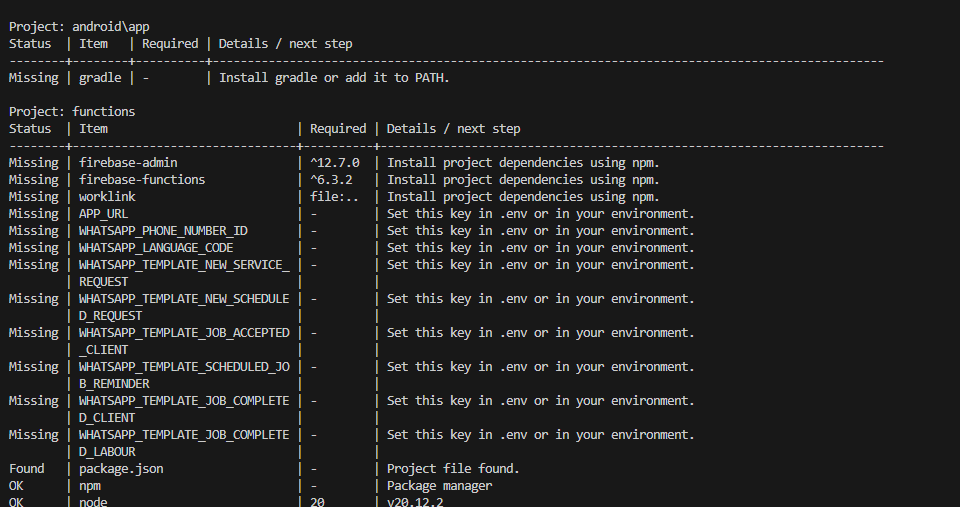

# Project Ready

Check a repository for missing packages, incompatible Node.js versions and missing environment variables. The CLI groups results by project folder and shows what to fix in a terminal table.

## Quick start

With Node.js 22 or newer, open a terminal in the repository you want to inspect and run:

```sh
npx @phani50101/project-ready@beta
```

[View the beta on npm](https://www.npmjs.com/package/@phani50101/project-ready)

## Example scan



In this scan, the functions folder declares Firebase packages that the scanner could not find locally. Its environment template also lists keys that are missing from the checked environment. The last column suggests a next step for each row.

## Command options

```sh
npx @phani50101/project-ready@beta ./my-project
npx @phani50101/project-ready@beta --json
npx @phani50101/project-ready@beta --strict
```

Python, Rust and .NET manifest readers also require Python 3.11 or newer on PATH.

## What this beta can verify

| Ecosystem | What is inspected | Limit |
| --- | --- | --- |
| JavaScript, TypeScript (including React, Next, Vue, Angular) | package.json direct, development, optional and peer declarations; installed node_modules versions; semver ranges; Node engine; package manager on PATH | Scan from workspace root for hoisted packages. Yarn Plug'n'Play, aliases, Git and workspace ranges are unverified. Missing dev packages may be intentional in production installs. |
| Python | PEP 621, basic Poetry declarations and simple requirements.txt entries; installed dist-info in a local .venv, venv or active virtual environment | Checks presence, not Python version constraints. Complex directives, environment markers, optional groups and global installs require review. |
| PHP | Composer direct requirements and installed.json | Installed versions listed. Platform and virtual packages and constraints are unverified. |
| Go | Standard single-line and grouped require directives; go executable | Inventory only. No cache resolution or replace evaluation. |
| Rust | Cargo normal, dev, build, workspace and target declarations; cargo executable | Inventory only. |
| .NET | Explicit PackageReference declarations in .csproj | Inventory only. No MSBuild property evaluation. |
| Ruby, Dart, Maven, Gradle, Swift | Recognizes common manifest files and checks expected tool or wrapper presence | Does not enumerate packages in these ecosystems yet. |
| Environment | Names in .env.example compared with .env and exported variables | Presence only. Does not print values or evaluate dotenv syntax. |

## Interpreting results

**present** verified presence or compatible Node range. **missing** expected item not found. **mismatch** an installed Node version or package violates a supported range. **declared** inventory only. **found-unverified** found installation evidence without a verified version match. **unknown** needs manual review. **error** unreadable input or unavailable reader.

Normal exit 0 means the scan finished. With --strict, confirmed missing items or version mismatches return 1. Unreadable projects, missing readers or no recognized project return 2. Unverified rows do not fail strict mode. Results cover declared direct dependencies, not unused imports, transitive requirements, security advisories or every custom build system. Hidden directories, common build/dependency trees and symlinked directories are excluded during discovery.

## Extending coverage

Add static manifest readers in bin/ready.cjs (or bin/manifests.py for Python standard library formats). Emit the project, type, name, requested range, evidence status and detail for each item. Distinguish declaration, installation and version compatibility. For a new ecosystem, cover fresh checkout, complete install, intentional optional omission, malformed manifest and workspace layouts before advertising installed-package checks.

Bundled semver is distributed under its included license in vendor/semver.
